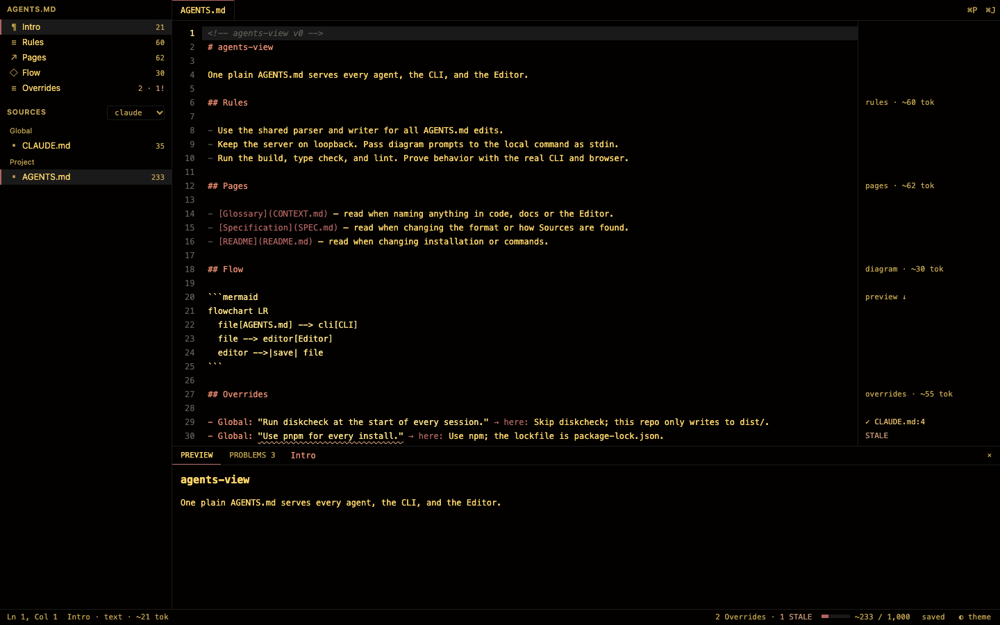

# Agents View

One plain `AGENTS.md` for every coding agent, and a fast local Editor to keep it sharp.



Agents View edits your project's `AGENTS.md` like code, in a local browser Editor, and shows what each agent actually reads. Claude Code, Codex, OpenCode, Gemini CLI, Cursor and GitHub Copilot are supported. Words used here are defined in [CONTEXT.md](CONTEXT.md).

## Install

```sh
brew install wlkr-si/tap/agents-view                  # macOS and Linux
npx @wlkr-si/agents-view                              # or: npm install -g @wlkr-si/agents-view
curl -fsSL https://raw.githubusercontent.com/wlkr-si/agents-view/main/install.sh | sh
```

Every installer checks the download against the release's `checksums.txt`. Archives for macOS and Linux (arm64 and amd64) are on [GitHub Releases](https://github.com/wlkr-si/agents-view/releases). Windows builds are best-effort. To build from source with Go 1.24 or later: `go install -ldflags="-s -w" github.com/wlkr-si/agents-view/cmd/agents-view@latest`.

## Use

Run `agents-view` in a project folder. The Editor opens on that folder's `AGENTS.md`.

- **AGENTS.md tab.** The whole file, editable. The outline jumps to a section. The side column shows each section's type and tokens, and where each Override's Global text was found. The status bar tracks the 1,000-token budget. ⌘S saves. If an agent changes the file while you have unsaved edits, the Editor warns instead of overwriting.
- **Sources.** Pick an agent to see the instruction files it reads, in load order: Global, Project, Auto memory and Nested. Open a Global file and click **Override** on a line to replace it for this project only. The Override is written to `## Overrides` in `AGENTS.md`.
- **Preview and Problems.** Preview follows the cursor and draws diagram sections offline. Problems lists STALE Overrides, missing page links, an over-budget file, and agents that won't read `AGENTS.md`.
- **Keys.** ⌘P or Ctrl+P jumps to a section or Source. ⌘J or Ctrl+J toggles the panel.

To change a diagram, describe the change in Preview. The prompt goes on stdin to `codex exec -s workspace-write -`. To use another command, set `AGENTS_VIEW_AGENT_COMMAND` to a JSON array of arguments. The Editor listens on a free loopback port. Set `AGENTS_VIEW_PORT` to fix the port.

## Commands for agents

| Command | Result |
| --- | --- |
| `agents-view sections` | List sections with type and approximate tokens |
| `agents-view read [section]` | Print the file or one section |
| `agents-view write <section> < body.md` | Replace a section's body, creating it if needed |
| `agents-view check` | Report format errors, broken page links, STALE Overrides and budget warnings |
| `agents-view sources [--agent claude\|codex\|opencode\|gemini\|cursor\|copilot]` | List Sources in load order |
| `agents-view --no-open` | Start the Editor and print its address |
| `agents-view --version` | Print the version |

The format is a small open convention described in [SPEC.md](SPEC.md). Other tools may implement it.

## Themes

Themes are [Omarchy](https://omarchy.org) `colors.toml` files, used unchanged. Every Omarchy theme works.

| Command | Result |
| --- | --- |
| `agents-view theme` | List themes. An asterisk marks the active one |
| `agents-view theme use system` | Norwegian Wood Sunrise when the system is dark, Flexoki Light when light (default) |
| `agents-view theme use <name>` | Use a bundled or installed theme |
| `agents-view theme use omarchy` | Follow the current Omarchy theme |
| `agents-view theme add <git-url>` | Install the `colors.toml` from a theme's repository |

You can also drop a `colors.toml` onto the Editor, or put one in `~/.config/agents-view/themes/<name>/`. Settings live in `~/.config/agents-view/settings.toml`, and `XDG_CONFIG_HOME` moves them.

Bundled themes: [Norwegian Wood Sunrise](https://github.com/ArveLomsland/norwegian-wood-sunrise) (its `colors.toml` only; a [license request](https://github.com/ArveLomsland/norwegian-wood-sunrise/issues/2) is open) and [Flexoki Light](https://github.com/basecamp/omarchy/tree/master/themes/flexoki-light) from Omarchy ([MIT](themes/flexoki-light/LICENSE)).

## Promise

- The Editor's own files are under 20 KB gzipped. Diagrams load only when one is on screen.
- The Editor answers in under 50 ms after launch.
- One binary under 10 MB, with no runtime to install.
- No network calls on its own: no analytics, no update checks. `theme add` fetches only the link you give it.

Every change runs `go run ./tools/budget`, which fails the build when a number is broken.

## Contributing

Issues and pull requests are welcome. The plan lives in the [tracking issue](https://github.com/wlkr-si/agents-view/issues/16). Run `go build ./...`, `go vet ./...`, `gofmt -l .` and `go run ./tools/budget` before opening a pull request. Releases are described in [docs/RELEASING.md](docs/RELEASING.md).

MIT licensed. See [LICENSE](LICENSE).
